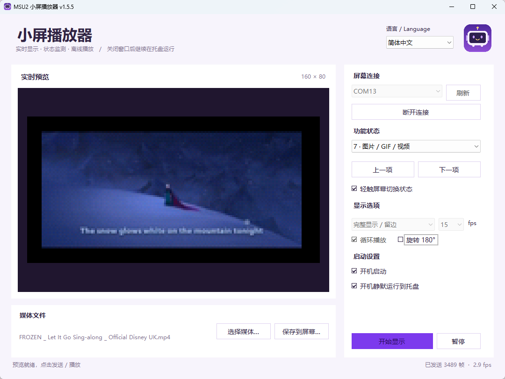

# MSU2 Mini Player / MSU2 小屏播放器

Windows 上的 160 × 80 MSU2 MINI 屏幕播放器，支持实时画面、电脑状态监测和离线动画。界面支持简体中文与 English。

## 运行截图 / Screenshot

播放器连接 MSU2 屏幕并实时播放视频的界面。



## 快速开始

1. 将 MSU2 MINI 屏幕接入电脑，确认 Windows 能正常识别其串口。
2. 启动 `src/Msu2Player.exe`。首次使用媒体功能时，若找不到 FFmpeg，程序会提示下载并安装，完成后自动重试。也可将 `ffmpeg.exe` 放在播放器旁边，或配置到系统 PATH。
3. 在右上角 **语言 / Language** 选择简体中文或 English。切换立即生效，语言偏好自动保存，下次启动继续使用。
4. 选择功能状态，点击 **连接屏幕**，再点击 **开始显示**。图片、GIF 和视频模式需要先选择文件，也可以将文件拖入窗口。

首次启动跟随 Windows 的界面语言：中文系统使用简体中文，其他语言使用 English。切换语言会保留当前模式、显示选项和播放状态。

## 串口自动识别

程序根据屏幕的 USB 标识 `VID_1A86&PID_FE0C&MI_00` 查找当前有效的串口，再验证屏幕协议和 160 × 80 分辨率，**不要求固定使用 COM13**。换电脑、换 USB 插口后，即使端口号变化也可以识别。

- 启动前已插入屏幕：启动时自动检测并选择端口。
- 普通启动后才插入屏幕：点击 **刷新**，再连接。
- 开机启动模式：每隔约 5 秒重新检测并尝试连接。
- 接入多个同型号屏幕时，请在列表中选择目标端口；程序优先保留当前或上次使用的有效端口。

运行过程中屏幕断电或拔出 USB 后，播放器会保留当前模式与播放意图，每隔约 5 秒重新检测串口。重连后继续原来的显示模式和播放状态，即使串口号变化也会重新识别。若断电前已暂停或播放结束，重连后恢复最后显示的画面并保持暂停。在等待期间点击 **暂停** 可暂停恢复播放，点击 **取消连接** 或主动 **断开连接** 可停止自动重连。播放器需要持续运行。

未找到屏幕时，检查 USB 数据线、串口驱动及设备是否已接入；连接失败时，先退出占用该端口的其他屏幕软件，再刷新重试。

## 显示模式

| 编号 | 模式 | 说明 |
| --- | --- | --- |
| 0 | 屏幕内动图 | 循环显示屏幕已存储的 36 帧 |
| 1 / 2 | 电脑状态 | 蓝色或红色面板，显示 CPU、内存、电量 / 电源与系统盘使用情况 |
| 3 | 屏幕内照片 | 显示屏幕原有照片槽位 |
| 4 | 时钟 | 时分、时分秒或带毫秒的时间 |
| 5 | 桌面投屏 | 选择显示器，将桌面缩放到小屏 |
| 6 | 网速 | 显示上传、下载速度与趋势 |
| 7 | 图片 / GIF / 视频 | 选择或拖入文件，实时解码并发送到屏幕 |

支持完整显示留边、铺满裁切、拉伸、180° 旋转及媒体循环播放。可选帧率为 1、2、5、10、15 fps；实际发送速度取决于设备和内容。勾选 **轻触屏幕切换状态** 后，可轻触屏幕依次切换模式。

实时预览支持全屏显示。双击画面、点击预览标题旁的 **全屏** 按钮，或右键选择 **全屏** 即可进入。按 **Esc**、再次双击画面，或右键选择 **退出全屏** 可返回窗口。全屏显示在预览所在的显示器上，画面保持 160×80 的比例并持续更新。

## 托盘与开机启动

- 关闭主窗口会隐藏到托盘，并继续运行；双击托盘图标可恢复窗口。
- 托盘菜单提供打开窗口、暂停 / 继续和退出播放器。
- **开机启动**：登录当前 Windows 账户后恢复上次的显示模式与媒体，并尝试连接屏幕。需要持续运行播放器才能显示实时内容。
- **开机静默运行到托盘**：开机时隐藏主窗口；未勾选时以最小化窗口启动。
- 移动播放器位置后，请重新设置开机启动，使启动路径指向新的位置。

## 保存到屏幕，离线播放

在状态 **0 · 屏幕内动图**、**3 · 屏幕内照片** 或 **7 · 图片 / GIF / 视频** 下，均可点击 **选择媒体…** 或拖入素材。选择后启用 **保存到屏幕…**，并保留当前状态。

- **状态 0**：写入屏幕内动图，生成 36 帧、3.6 秒的循环动画。
- **状态 3**：选取一帧写入屏幕照片槽位，保留同扇区的相邻资源。默认仅读取需要保留的相邻资源，也可勾选备份整个目标区域、写入后完整校验。图片直接生成照片，GIF / 视频可通过截取开始时间选择画面。保存后选择状态 3 并点击 **开始显示**。
- **状态 7**：保留原有保存离线动画的功能。

保存动画时的操作步骤如下：

1. 选择截取开始时间，点击 **生成并预览**。
2. 图片保存为固定画面；GIF / 视频生成 **36 帧、3.6 秒**的循环动画。
3. 点击 **写入屏幕**并确认。**写入前备份原内容（较慢）** 和 **写入后完整校验** 均为独立可选项，默认不勾选，写完即结束。需要保留原内容时可勾选备份，备份阶段可以取消。勾选完整校验后会逐字节读回全部写入区域并比较，耗时取决于设备。完成提示会显示是否执行了完整校验。
4. 完成后退出所有屏幕播放器，重新插拔屏幕。保持 USB 供电即可离线播放；必要时轻触屏幕切回动画页面。

写入记录及勾选后生成的备份位于播放器旁的 `离线备份/时间戳-标识/` 目录中。可使用 **恢复备份…** 选择已有的 `原离线动画.bin`，恢复时同样可选择是否备份当前内容。默认不会保存被替换的原动画或照片。只能在可选的备份阶段取消，写入和校验期间请保持 USB 连接与供电。若设备的离线布局不符合支持的标准，程序会停止操作。

状态 3 的保存窗口可恢复 `原屏幕照片.bin` 或 `照片扇区-3920-4031.bin`。后者包含相邻资源，可用于恢复照片写入中断后的整个目标扇区区域。状态 3 使用播放器的照片槽位，断电重启后的默认显示由设备固件决定。

## FFmpeg 依赖与自动下载

**图片、GIF 和视频的预览、实时播放，以及离线动画生成需要 FFmpeg。** 屏幕内置动画 / 照片、电脑状态、时钟、桌面投屏和网速不依赖 FFmpeg。

程序依次查找播放器旁的 `ffmpeg.exe`、当前用户的 FFmpeg 安装目录、Chocolatey 安装位置和 PATH。缺失时显示中英文提示，点击 **下载并继续** 后自动下载、显示进度、校验 SHA256、解压并检查能否运行，成功后继续加载媒体。可取消下载，失败后可重试或通过窗口中的官网链接手动下载。

[FFmpeg 官网](https://ffmpeg.org/download.html)只提供源码；自动下载使用其下载页列出的 [Gyan Windows 构建](https://www.gyan.dev/ffmpeg/builds/)（release essentials ZIP，64 位 Windows）。程序使用下载源提供的 SHA256 校验下载完整性，保留随包提供的许可证和说明文件。文件保存到 `%LOCALAPPDATA%\MSU2MiniPlayer\ffmpeg\`，无需管理员权限；取消或失败时清理临时文件，不会将未完成的下载当作已安装版本。自动下载仅支持 64 位 Windows，构建提供方要求 Windows 10 或更高版本；其他系统可手动提供兼容的 `ffmpeg.exe`。

静默开机时缺少 FFmpeg 会显示托盘提示，打开主窗口后处理下载。取消下载仍可使用不依赖 FFmpeg 的显示模式；选择媒体或点击 **开始显示** 可再次尝试。

## 配置与构建

播放器将语言、端口、媒体路径和显示选项保存到程序旁的 `settings.xml`，请将程序放在当前账户可写的目录。原有配置文件可继续使用；缺少语言设置时跟随 Windows 界面语言。

从项目根目录执行：

```powershell
powershell -NoProfile -ExecutionPolicy Bypass -File .\src\build.ps1
```

构建脚本使用 Windows 的 .NET Framework 4.x C# 编译器与 WinForms，运行需要 .NET Framework 4.5 或更高版本，输出 `src/Msu2Player.exe`。图标资源在 `src/icons/`；媒体解码器可在缺失时自动下载。语言切换回归测试在 `work/LanguageTests.cs`；测试运行方法见 `work/test-language.ps1`，不连接串口、不写入屏幕，也不修改开机启动设置。

FFmpeg 查找、校验、解压与下载窗口测试：`powershell -NoProfile -ExecutionPolicy Bypass -File .\tests\test-ffmpeg.ps1`。加上 `-Download` 可测试真实下载、取消清理、重试和图片解码，文件仅保存在 `tests/output/`，不安装到用户目录或连接屏幕。

`work/README.md` 与 `协议分析.md` 是硬件和协议分析资料。部分开发用硬件测试入口仍使用 COM13；它们与正常界面的自动串口识别相互独立。

## English

MSU2 Mini Player is a Windows player for **160 × 80 MSU2 MINI** screens. It supports live media, PC statistics, desktop mirroring, clocks, network speed, stored photos and animations.

### Getting started

1. Connect the screen and ensure Windows recognizes its serial port.
2. Run `src/Msu2Player.exe`. If FFmpeg is missing when using media, click **Download** in the prompt. The player installs it and retries automatically. You can also place `ffmpeg.exe` beside the player or on PATH.
3. Select **English** from **语言 / Language** at the top right. Changes apply immediately and persist across restarts. The first launch follows the Windows UI language: Chinese uses Simplified Chinese; other languages use English.
4. Choose a display mode, click **Connect**, then **Start display**. For image / GIF / video mode, use **Open file...** or drop a media file into the window.

The player detects the screen by USB identifier (`VID_1A86&PID_FE0C&MI_00`), then validates its protocol and resolution. **COM13 is not required**. A different COM number on another PC works automatically. If you plug in the screen after a normal launch, click **Refresh**. Login startup retries detection and connection about every five seconds. With multiple matching screens, select the intended port.

While the player is running, power loss or USB removal starts automatic port detection and reconnection about every five seconds. The player resumes the selected mode and playback state when the screen returns, including after a COM number change. Paused or completed playback restores the last displayed frame and stays paused. You can pause playback while waiting, or use **Cancel connection** / **Disconnect** to stop reconnection.

### Controls and startup

Modes 0–7 cover stored animation, blue / red PC status, stored photo, clock, desktop mirror, network speed, and media playback. Display options include fit, crop, stretch, rotation, loop and target frame rate. Tap switching can cycle through the modes.

Double-click the live preview, click **Fullscreen** beside its title, or right-click and choose **Fullscreen**. Press **Esc**, double-click again, or right-click and choose **Exit fullscreen** to return. Fullscreen uses the preview's current monitor, preserves the 160×80 aspect ratio and continues updating the live image.

Closing the window keeps the player running in the tray. Double-click the tray icon to reopen it, or use its menu to pause, resume or exit. **Start at login** resumes the last mode and media when you sign in. **Start hidden in tray** hides the startup window. Reconfigure login startup after moving the executable.

### Offline playback

In modes **0**, **3** and **7**, use **Open file...** or drop media into the window. Selecting media keeps the current mode and enables **Save offline...**. Modes 0 and 7 write a **36-frame, 3.6-second animation**. Mode 3 writes a **single photo frame** to the stored photo slot. For a GIF or video, choose the frame using the start time. Click **Build preview**, then **Write to screen**. After saving a photo, select mode 3 and click **Start display**.

**Back up original content (slower)** and **Full verification after writing** are independent options, both off by default. A write finishes after the device acknowledges the written pages. Enable verification to read back and compare the entire written region. The completion message states whether full verification ran. Photo writes read and preserve the adjacent resource fragments sharing the erase sectors. The photo dialog can restore either `原屏幕照片.bin` or the complete `照片扇区-3920-4031.bin` backup. The device firmware determines the default display after power cycling. Cancel is available during the optional backup stage. Keep USB power and the connection intact during writing and verification.

After completion, exit all screen players and reconnect the screen. It plays from USB power alone. Tap it to return to animation if needed. Write records and optional backups are stored under `离线备份/` beside the executable. Use **Restore...** to select an existing `原离线动画.bin` from a backup folder. The replaced content is saved only when you enable backup. Unsupported offline layouts are rejected before erasing or writing.

### Settings and building

FFmpeg is required for image / GIF / video preview and playback, and offline animation generation. Other modes work without it. Missing dependencies trigger a bilingual download dialog with progress, cancellation and retry. Since the [FFmpeg website](https://ffmpeg.org/download.html) provides source code, the downloader uses the Windows 64-bit release essentials ZIP from [Gyan](https://www.gyan.dev/ffmpeg/builds/), a provider listed on that page. It verifies the provider's SHA256 checksum, extracts the executable with its license and README, checks that it runs, and stores it under `%LOCALAPPDATA%\MSU2MiniPlayer\ffmpeg\` without administrator access. Automatic download requires 64-bit Windows; the provider targets Windows 10 or later. You may supply a compatible build manually on other systems. Hidden login startup shows a tray notification and defers the dialog until the main window is opened.

Settings, including language, are stored in `settings.xml` beside the executable; use a writable folder. Existing settings remain compatible. Build from the project root with the PowerShell command above using the Windows .NET Framework 4.x compiler; .NET Framework 4.5 or later is required to run. Run `work/test-language.ps1` for language regression checks. Run `tests/test-ffmpeg.ps1` for dependency tests, optionally with `-Download` for a real download and decode test in `tests/output/`. Tests do not open serial ports, write screen flash, or change startup registry settings.
