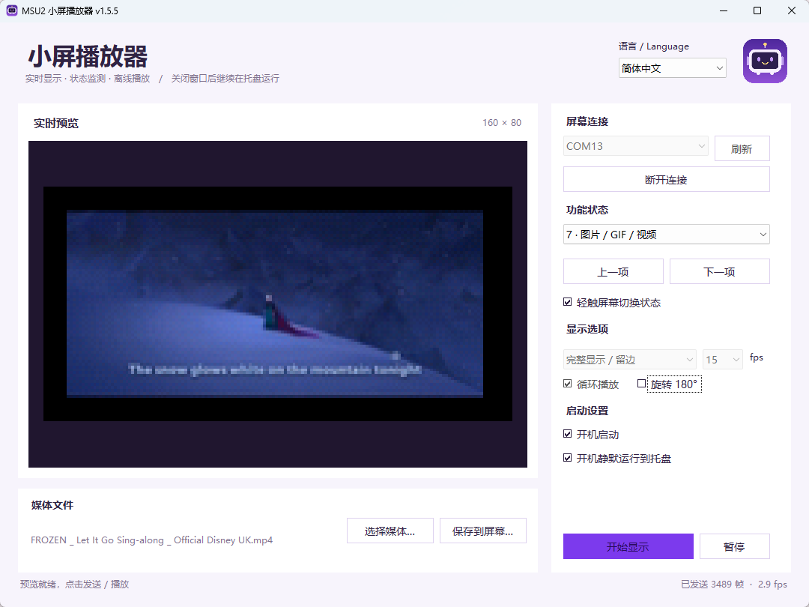

# MSU2 Mini Player / MSU2 小屏播放器

Windows 上的 160 × 80 MSU2 MINI 屏幕播放器，支持实时画面、电脑状态监测和离线动画。界面支持简体中文与 English。

## 运行截图 / Screenshot

播放器连接 MSU2 屏幕并实时播放视频的界面。



## 快速开始

1. 将 MSU2 MINI 屏幕接入电脑，确认 Windows 能正常识别其串口。
2. 启动 `src/Msu2Player.exe`。首次使用媒体功能时，若找不到 FFmpeg，程序会提示下载并安装，完成后自动重试。也可将 `ffmpeg.exe` 放在播放器旁边，或配置到系统 PATH。
3. 在右上角 **语言 / Language** 选择简体中文或 English。切换立即生效，语言偏好自动保存，下次启动继续使用。
4. 选择功能状态，点击 **连接屏幕**，再点击 **开始显示**。图片、GIF 和视频模式需要先选择文件，也可以将文件拖入窗口。

首次启动跟随 Windows 的界面语言：中文系统使用简体中文，其他语言使用 English。切换语言会保留当前模式、显示选项和播放状态。

## 串口自动识别

程序根据屏幕的 USB 标识 `VID_1A86&PID_FE0C&MI_00` 查找当前有效的串口，再验证屏幕协议和 160 × 80 分辨率，**不要求固定使用 COM13**。换电脑、换 USB 插口后，即使端口号变化也可以识别。

- 启动前已插入屏幕：启动时自动检测并选择端口。
- 普通启动后才插入屏幕：点击 **刷新**，再连接。
- 开机启动模式：每隔约 5 秒重新检测并尝试连接。
- 接入多个同型号屏幕时，请在列表中选择目标端口；程序优先保留当前或上次使用的有效端口。

未找到屏幕时，检查 USB 数据线、串口驱动及设备是否已接入；连接失败时，先退出占用该端口的其他屏幕软件，再刷新重试。

## 显示模式

| 编号 | 模式 | 说明 |
| --- | --- | --- |
| 0 | 屏幕内动图 | 循环显示屏幕已存储的 36 帧 |
| 1 / 2 | 电脑状态 | 蓝色或红色面板，显示 CPU、内存、电量 / 电源与系统盘使用情况 |
| 3 | 屏幕内照片 | 显示屏幕原有照片槽位 |
| 4 | 时钟 | 时分、时分秒或带毫秒的时间 |
| 5 | 桌面投屏 | 选择显示器，将桌面缩放到小屏 |
| 6 | 网速 | 显示上传、下载速度与趋势 |
| 7 | 图片 / GIF / 视频 | 选择或拖入文件，实时解码并发送到屏幕 |

支持完整显示留边、铺满裁切、拉伸、180° 旋转及媒体循环播放。可选帧率为 1、2、5、10、15 fps；实际发送速度取决于设备和内容。勾选 **轻触屏幕切换状态** 后，可轻触屏幕依次切换模式。

## 托盘与开机启动

- 关闭主窗口会隐藏到托盘，并继续运行；双击托盘图标可恢复窗口。
- 托盘菜单提供打开窗口、暂停 / 继续和退出播放器。
- **开机启动**：登录当前 Windows 账户后恢复上次的显示模式与媒体，并尝试连接屏幕。需要持续运行播放器才能显示实时内容。
- **开机静默运行到托盘**：开机时隐藏主窗口；未勾选时以最小化窗口启动。
- 移动播放器位置后，请重新设置开机启动，使启动路径指向新的位置。

## 保存到屏幕，离线播放

在图片 / GIF / 视频模式中选择媒体，点击 **保存到屏幕…**：

1. 选择截取开始时间，点击 **生成并预览**。
2. 图片保存为固定画面；GIF / 视频生成 **36 帧、3.6 秒**的循环动画。
3. 点击 **写入屏幕**并确认。程序先备份原动画，再写入并逐字节校验，整个过程可能约需 15 分钟。
4. 完成后退出所有屏幕播放器，重新插拔屏幕。保持 USB 供电即可离线播放；必要时轻触屏幕切回动画页面。

备份位于播放器旁的 `离线备份/时间戳-标识/` 目录中。可使用 **恢复备份…** 选择其中的 `原离线动画.bin`，恢复过程也会先备份当前内容。只能在备份阶段取消；写入和校验期间请保持 USB 连接与供电。若设备的离线布局不符合支持的标准，程序会停止操作。

## FFmpeg 依赖与自动下载

**图片、GIF 和视频的预览、实时播放，以及离线动画生成需要 FFmpeg。** 屏幕内置动画 / 照片、电脑状态、时钟、桌面投屏和网速不依赖 FFmpeg。

程序依次查找播放器旁的 `ffmpeg.exe`、当前用户的 FFmpeg 安装目录、Chocolatey 安装位置和 PATH。缺失时显示中英文提示，点击 **下载并继续** 后自动下载、显示进度、校验 SHA256、解压并检查能否运行，成功后继续加载媒体。可取消下载，失败后可重试或通过窗口中的官网链接手动下载。

[FFmpeg 官网](https://ffmpeg.org/download.html)只提供源码；自动下载使用其下载页列出的 [Gyan Windows 构建](https://www.gyan.dev/ffmpeg/builds/)（release essentials ZIP，64 位 Windows）。程序使用下载源提供的 SHA256 校验下载完整性，保留随包提供的许可证和说明文件。文件保存到 `%LOCALAPPDATA%\MSU2MiniPlayer\ffmpeg\`，无需管理员权限；取消或失败时清理临时文件，不会将未完成的下载当作已安装版本。自动下载仅支持 64 位 Windows，构建提供方要求 Windows 10 或更高版本；其他系统可手动提供兼容的 `ffmpeg.exe`。

静默开机时缺少 FFmpeg 会显示托盘提示，打开主窗口后处理下载。取消下载仍可使用不依赖 FFmpeg 的显示模式；选择媒体或点击 **开始显示** 可再次尝试。

## 配置与构建

播放器将语言、端口、媒体路径和显示选项保存到程序旁的 `settings.xml`，请将程序放在当前账户可写的目录。原有配置文件可继续使用；缺少语言设置时跟随 Windows 界面语言。

从项目根目录执行：

```powershell
powershell -NoProfile -ExecutionPolicy Bypass -File .\src\build.ps1
```

构建脚本使用 Windows 的 .NET Framework 4.x C# 编译器与 WinForms，运行需要 .NET Framework 4.5 或更高版本，输出 `src/Msu2Player.exe`。图标资源在 `src/icons/`；媒体解码器可在缺失时自动下载。语言切换回归测试在 `work/LanguageTests.cs`；测试运行方法见 `work/test-language.ps1`，不连接串口、不写入屏幕，也不修改开机启动设置。

FFmpeg 查找、校验、解压与下载窗口测试：`powershell -NoProfile -ExecutionPolicy Bypass -File .\tests\test-ffmpeg.ps1`。加上 `-Download` 可测试真实下载、取消清理、重试和图片解码，文件仅保存在 `tests/output/`，不安装到用户目录或连接屏幕。

`work/README.md` 与 `协议分析.md` 是硬件和协议分析资料。部分开发用硬件测试入口仍使用 COM13；它们与正常界面的自动串口识别相互独立。

## English

MSU2 Mini Player is a Windows player for **160 × 80 MSU2 MINI** screens. It supports live media, PC statistics, desktop mirroring, clocks, network speed, stored photos and animations.

### Getting started

1. Connect the screen and ensure Windows recognizes its serial port.
2. Run `src/Msu2Player.exe`. If FFmpeg is missing when using media, click **Download** in the prompt. The player installs it and retries automatically. You can also place `ffmpeg.exe` beside the player or on PATH.
3. Select **English** from **语言 / Language** at the top right. Changes apply immediately and persist across restarts. The first launch follows the Windows UI language: Chinese uses Simplified Chinese; other languages use English.
4. Choose a display mode, click **Connect**, then **Start display**. For image / GIF / video mode, use **Open file...** or drop a media file into the window.

The player detects the screen by USB identifier (`VID_1A86&PID_FE0C&MI_00`), then validates its protocol and resolution. **COM13 is not required**. A different COM number on another PC works automatically. If you plug in the screen after a normal launch, click **Refresh**. Login startup retries detection and connection about every five seconds. With multiple matching screens, select the intended port.

### Controls and startup

Modes 0–7 cover stored animation, blue / red PC status, stored photo, clock, desktop mirror, network speed, and media playback. Display options include fit, crop, stretch, rotation, loop and target frame rate. Tap switching can cycle through the modes.

Closing the window keeps the player running in the tray. Double-click the tray icon to reopen it, or use its menu to pause, resume or exit. **Start at login** resumes the last mode and media when you sign in. **Start hidden in tray** hides the startup window. Reconfigure login startup after moving the executable.

### Offline playback

In media mode, click **Save offline...**, choose a start time and **Build preview**, then **Write to screen**. Still images remain static; GIFs and videos become a **36-frame, 3.6-second loop**. The player backs up the original animation and fully verifies the write. The process may take about 15 minutes. Cancel is available during backup; keep USB power and the connection intact during writing and verification.

After completion, exit all screen players and reconnect the screen. It plays from USB power alone. Tap it to return to animation if needed. Backups are stored under `离线备份/` beside the executable. Use **Restore...** to select `原离线动画.bin` from a backup folder. Unsupported offline layouts are rejected before erasing or writing.

### Settings and building

FFmpeg is required for image / GIF / video preview and playback, and offline animation generation. Other modes work without it. Missing dependencies trigger a bilingual download dialog with progress, cancellation and retry. Since the [FFmpeg website](https://ffmpeg.org/download.html) provides source code, the downloader uses the Windows 64-bit release essentials ZIP from [Gyan](https://www.gyan.dev/ffmpeg/builds/), a provider listed on that page. It verifies the provider's SHA256 checksum, extracts the executable with its license and README, checks that it runs, and stores it under `%LOCALAPPDATA%\MSU2MiniPlayer\ffmpeg\` without administrator access. Automatic download requires 64-bit Windows; the provider targets Windows 10 or later. You may supply a compatible build manually on other systems. Hidden login startup shows a tray notification and defers the dialog until the main window is opened.

Settings, including language, are stored in `settings.xml` beside the executable; use a writable folder. Existing settings remain compatible. Build from the project root with the PowerShell command above using the Windows .NET Framework 4.x compiler; .NET Framework 4.5 or later is required to run. Run `work/test-language.ps1` for language regression checks. Run `tests/test-ffmpeg.ps1` for dependency tests, optionally with `-Download` for a real download and decode test in `tests/output/`. Tests do not open serial ports, write screen flash, or change startup registry settings.
